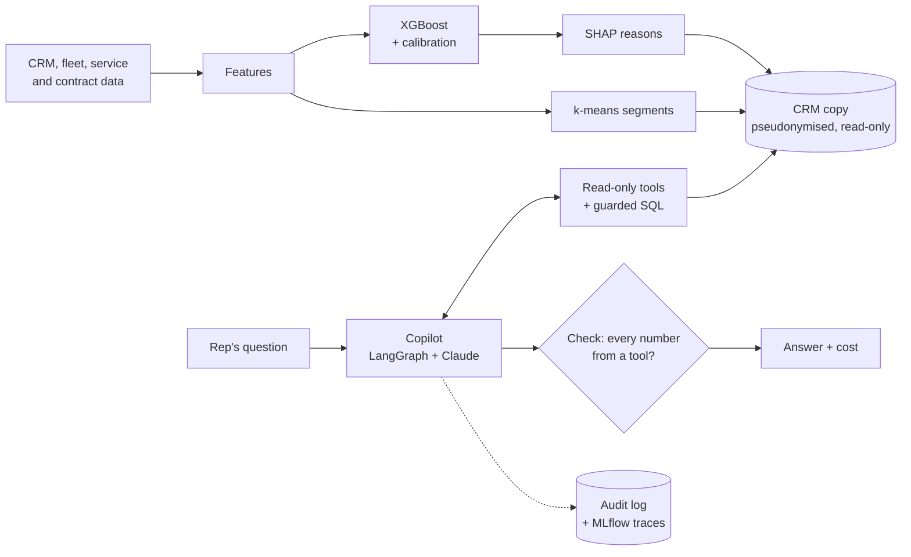

# 🚚 FleetPilot

**Which fleet customers will order new trucks in the next 6 months, why, and what to say to them.**
An ML model ranks customers and explains each score; an AI sales copilot answers reps' questions from the data,
with every number checked, logged and priced.

[](https://github.com/saeedm31/FleetPilot/actions/workflows/ci.yml)
[](https://www.python.org/)
[](https://xgboost.ai/)
[](https://www.langchain.com/langgraph)
[](https://mlflow.org/)
[](#-run-it)
[](LICENSE)

▶️ **[Live app](https://sh-fleetpilot.streamlit.app)** · 🏗️ **[Architecture](docs/architecture.md)** · 📇 **[Model card](docs/model_card.md)** · 🔒 **[Security](SECURITY.md)**

> **Simulated data** for a fictional truck maker: 2,000 fleet customers over 3 years, fake company names.
> The simulator knows the true buying rule, so the models can be scored honestly. The numbers show the method,
> not a real sales team's results.

---

## 💡 Why this app

A truck maker sells to fleet owners: logistics firms, builders, delivery companies, city services. A new truck order
is big (often several trucks at once), but it comes rarely and at a time the customer picks. If our rep calls too
late, a competitor has already sent a quote. If the rep calls too early, the visit is wasted.

The sales team has the data to see an order coming: fleet age, service costs and breakdowns, when financing and service
contracts end, past orders, visits and quotes. But it sits in different systems, and nobody can read it for
2,000 customers every month. So many teams fall back on a simple rule: **call the oldest fleets first**. That rule
misses customers who buy for other reasons (a contract ending, a growing business, rising repair bills) and spends
time on old fleets that are not ready to buy.

## ✅ What it does

FleetPilot turns that data into a monthly call list a rep can trust, and a chat assistant to work with it.

1. **Ranks every customer** by the chance they order new trucks from us in the next 6 months.
2. **Explains each score** in plain words, e.g. *"financing ends for 40% of the fleet within 6 months"* or
   *"service cost +18% vs a year ago"*, so the rep knows why to call and what to talk about.
3. **Groups customers into segments** the team can plan around, e.g. *"high service costs, ageing trucks"* or
   *"young trucks, growing"*.
4. **Answers reps' questions** in a chat (an AI copilot built on Claude):
   *"Which customers in Portugal should I call first this week, and why?"*, *"Draft a first email to C-3F9A21"*,
   *"How many deals did we lose to competitors?"*. It reads only the data, and a check step makes sure every number
   in the answer comes from that data.
5. **Keeps a record of everything:** every question, tool call, answer and its cost goes to a tamper-evident audit
   log and to MLflow, and a budget caps the AI spend.

## 🎯 Why it matters

- **Reach more buyers with the same calls:** calling the top 10% of the list reaches 33% of all buyers, vs 26% with
  the "oldest fleets first" rule (on the simulated data). Same effort, about a quarter more buyers reached.
- **Better calls:** the rep goes in knowing the reason (contract ending, costs rising) instead of a generic pitch.
- **Less time digging in systems:** a question in the chat replaces a report request or a spreadsheet.
- **Safe to use in a company:** customer names never reach the AI, the AI can only read, every number it gives is
  checked and every step is logged, and costs are shown and capped. These are the things IT, legal and works councils ask about first.

## 🧠 How it works



**ML**
- **Purchase likelihood:** XGBoost on fleet, service, contract and sales features, calibrated so that 30% means 30%.
  Trained on older months and tested on later months it never saw. Compared with a logistic regression and with the
  "oldest fleets first" rule.
- **Reasons:** SHAP values per customer, turned into phrases such as *"financing ends for 40% of the fleet within
  6 months"*.
- **Segments:** k-means on fleet size, age, mileage, our share, growth and service cost, named automatically.

**AI agent**
- **LangGraph** runs the loop: Claude picks tools → tools run → Claude answers → **check step**.
- **Tools:** `top_customers`, `customer_profile`, `similar_won_deals`, `segment_overview`, and `run_sql` (read-only,
  one SELECT, allow-listed tables, row and time limits).
- **Check step:** every number in the answer must appear in a tool result. If not, the answer goes back once to be
  fixed. The result is shown under each answer (✅ or ⚠️).
- **Claude** through the Anthropic API or **Amazon Bedrock** (EU region, no key), switched with `LLM_PROVIDER`.

**Production practice**
- **Audit log:** append-only, hash-chained record of every question, Claude call, tool call, check and answer, with
  tokens and cost. `python -m fleetpilot audit-verify` proves nothing was changed.
- **MLflow:** training runs, the model registry, and a trace of every copilot run.
- **Cost meter:** tokens and euros per answer; a monthly (company) or session (demo) budget stops new questions.
- **Privacy:** customer IDs are keyed pseudonyms; Claude and the logs never see company names.
- **Evaluation:** 24 questions with answers taken from the database (right tool? right facts? grounded? declines
  out-of-scope and personal-data requests?). Offline in CI with a scripted model; live with real Claude.
- **Engineering:** tests, ruff + pre-commit, CI with a full Docker Compose run, settings from environment variables,
  JSON logs, [architecture decision records](docs/adr), [model card](docs/model_card.md), [data card](docs/data_card.md).

## 📊 Results

Scored on months 25-29, which the model never saw. 20% of customers order within 6 months. "Top 10% finds" is the
share of all buyers a rep reaches by calling the 10% highest-scored customers.

| Model | AUC | PR-AUC | Top 10% finds | Top 20% finds |
|---|---|---|---|---|
| Rule of thumb: oldest fleets first | 0.724 | 0.428 | 26% | 42% |
| Logistic regression | 0.821 | 0.535 | 32% | 52% |
| **XGBoost, calibrated (what the app uses)** | **0.839** | **0.582** | **33%** (3.3x lift) | **55%** |

- **Calibration:** Brier score 0.119; the calibration chart is in the app's "Can we trust it?" tab.
- **Copilot, offline evaluation:** 24 of 24 questions pass with the scripted model (right tool, right facts,
  grounded, declines out-of-scope and personal-data requests).
- **Copilot, live evaluation:** add an `ANTHROPIC_API_KEY` repository secret and run the **Live evaluation**
  workflow. It scores real Claude on the same 24 questions and records demo runs for the app.

## 🖥️ The app

| Tab | What it shows |
|---|---|
| 📞 Who to call | every customer ranked by chance to order, with the main reason; filters by country, industry, group |
| 🔍 One customer | why this customer is likely to buy, chance month by month, won and lost deals, similar won deals |
| 💬 Ask the AI | the chat: answer, ✅/⚠️ check badge, tools used, tokens, € cost |
| 📈 Explore the data | build your own interactive charts: scatter, histogram, box plot or bar, any column, colour and filters |
| 👥 Customer groups | the five customer groups (k-means segments) and how likely each is to order |
| 📊 Can we trust it? | model vs simpler methods on unseen months, calibration, AI assistant test |
| 🧾 Activity log | every AI question and step, with a tamper check |

**Modes:** **AI (Claude)** answers any question for visitors, using the owner's key from Streamlit secrets, capped
per visitor and per day. **Demo** needs no key: a scripted test model that shows the mechanics for a few question
types. **Live** uses your own Anthropic key for the session only.

## 🐳 Run it

```bash
git clone https://github.com/saeedm31/FleetPilot.git && cd FleetPilot
cp .env.example .env                 # add ANTHROPIC_API_KEY for live answers (optional)
docker compose up -d --build         # app: http://localhost:8501   MLflow: http://localhost:5000
docker compose run --rm pipeline     # retrain and register the model in MLflow
docker compose run --rm app python -m fleetpilot eval --live    # evaluate the copilot with real Claude
```

| Image | Purpose |
|---|---|
| `app` | Streamlit app + copilot, non-root, health check |
| `train` | batch job: simulate, train, score, register |
| `mlflow` | tracking server, model registry, trace UI |

**Without Docker:** `make install`, then `make build`, `streamlit run app.py`, `make test`.

**Command line:** `python -m fleetpilot ask "Which customers in Spain should I call first?"` · `eval [--live]` ·
`record` · `audit-verify`.

## 📁 Project structure

```
fleetpilot/
  sim.py               simulated customers, fleets, contracts, sales activity, orders
  features.py          features and their plain-English reasons
  model.py             XGBoost + calibration + SHAP; logistic and rule-of-thumb baselines
  segments.py          k-means segments with readable names
  pipeline.py          simulate -> train -> score -> segment -> CRM database (+ MLflow)
  store.py             SQLite CRM: read-only connection, SQL guard
  privacy.py           keyed pseudonyms
  agent/tools.py       the copilot's tools
  agent/graph.py       LangGraph: agent -> tools -> check, audit logging
  agent/check.py       grounding check
  agent/scripted.py    scripted stand-in for Claude (tests, offline evaluation)
  llm.py               Claude client (API or Bedrock) with cost meter
  audit.py             append-only hash-chained audit log
  evaluation.py        24-question evaluation set
app.py                 Streamlit app
docs/                  architecture, ADRs, model card, data card
```

## ⚠️ Limits

- Simulated data and a hand-made buying rule: real data is noisier and has gaps.
- The copilot answers from one month's snapshot; a real one would read the live CRM through read-only views.
- The check step catches numbers without a source, not wrong reasoning: reps stay in charge of the decision.

## License

[MIT](LICENSE)
