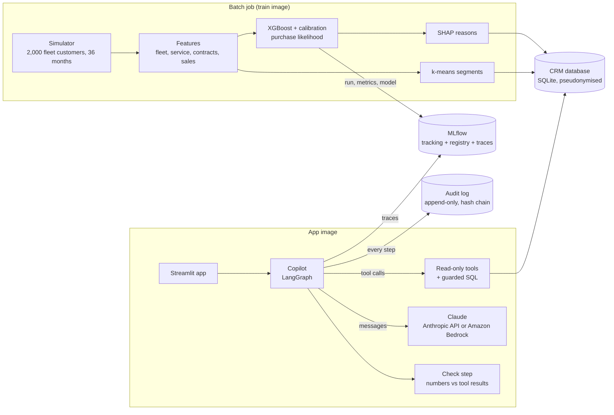
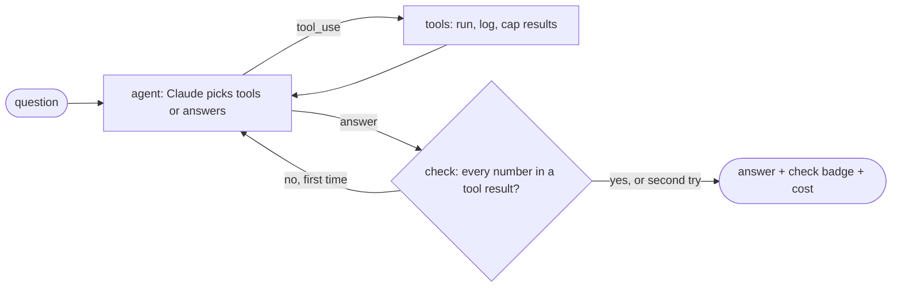

# Architecture

## The copilot graph

- **agent**: one Claude call with the tool definitions. After `max_agent_steps` tool rounds it must answer (`tool_choice: none`).
- **tools**: plain Python functions over a read-only connection. Results are capped (25 rows, 20 KB) so prompts stay small.
- **check**: extracts the numbers from the answer and looks for each in the tool results (rounding and score-as-percent allowed). If any is missing, the agent gets one chance to rewrite; the final check result is shown to the user and logged.

## Where things run

| Piece | Local / Docker | Public demo (Streamlit Cloud) | Company setup (AWS) |
|---|---|---|---|
| App + copilot | `app` container | Streamlit Cloud | ECS Fargate (as in [LexTreeRAG's AWS setup](https://github.com/saeedm31/LexTreeRAG/blob/aws/docs/aws.md)) |
| Claude | API key | visitor's own key, or demo mode | Amazon Bedrock, IAM role, EU region |
| Training | `pipeline` container | built at first start | scheduled ECS task |
| MLflow | `mlflow` container | not used | MLflow on ECS or SageMaker managed MLflow |
| CRM data | SQLite on a volume | SQLite file | the real CRM / warehouse, through read-only views |
| Audit log | SQLite on a volume | SQLite file (ephemeral) | a database with backups, or CloudWatch Logs |

## Data flow and privacy

1. The simulator creates customers with fake company names.
2. The pipeline replaces internal IDs with keyed pseudonyms (`C-3F9A21`, HMAC-SHA256 with `PSEUDONYM_KEY`) and writes
   the CRM database **without names**.
3. Names go to a separate file that only the app reads, to show them next to IDs on the rep's screen.
4. The copilot, Claude and the logs only ever see pseudonymised IDs.
